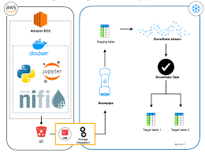

# Slowly Changing Dimensions in Snowflake — Streams, Tasks & Snowpipe

A near-real-time CDC pipeline. Generated customer data flows through Apache NiFi into Amazon S3, Snowpipe loads it into Snowflake, and scheduled tasks maintain an **SCD Type 1** current table and an **SCD Type 2** history table.



## Architecture

```mermaid
flowchart LR
    A[Faker notebook<br/>customer_YYYYMMDDHHMMSS.csv] --> B[Apache NiFi<br/>Docker on EC2]
    B --> C[(Amazon S3)]
    C -->|Snowpipe auto_ingest| D[customer_raw<br/>staging]
    D -->|tsk_scd_raw every 1 min<br/>pdr_scd_demo: MERGE + TRUNCATE| E[customer<br/>SCD Type 1]
    E -->|Stream: customer_table_changes| F[v_customer_change_data]
    F -->|tsk_scd_hist every 1 min<br/>MERGE| G[customer_history<br/>SCD Type 2]
```



## Tech stack

- **Snowflake:** Snowpipe, external stage, JavaScript stored procedure, Streams, Tasks, MERGE
- **Data movement:** Apache NiFi (with ZooKeeper and JupyterLab via Docker Compose)
- **Cloud:** Amazon S3, Amazon EC2
- **Data generation:** Python + Faker
- **Languages:** SQL, Python, JavaScript (stored procedure)

## What it demonstrates

- **Data generation:** `faker.ipynb` writes 10,000 fake customer records per run to a timestamped CSV
- **Ingestion:** an S3 external stage plus a Snowpipe (`auto_ingest = true`) loading `customer_raw`
- **SCD Type 1:**
  - stored procedure `pdr_scd_demo()` MERGEs `customer_raw` into `customer`: it updates changed rows, inserts new ones and refreshes `update_timestamp`
  - it then truncates the staging table
  - task `tsk_scd_raw` runs it every minute
- **Change capture:** stream `customer_table_changes` on `customer`
- **SCD Type 2:**
  - view `v_customer_change_data` turns stream rows into insert, update and delete actions, using `start_time` / `end_time` / `is_current`
  - task `tsk_scd_hist` MERGEs them into `customer_history`; deletes are logical, closing the current row
- **Least-privilege task execution:** a `TASKADMIN` role is granted `EXECUTE TASK`

## Project structure

```
scd-data-warehousing-with-snowflake/
├── architecture.png
├── faker.ipynb                   # test-data generator
├── docker_exp/docker-compose.yml # JupyterLab + ZooKeeper + NiFi
└── sqls/
    ├── 01 table_creation.sql     # warehouse, db, schema, customer / customer_history / customer_raw, stream
    ├── 02 data_ingestion.sql     # external stage + Snowpipe
    ├── 03 scd_type-1.sql         # MERGE, stored procedure, TASKADMIN role, tsk_scd_raw
    └── 04 scd_type-2.sql         # change-data view, tsk_scd_hist, test DML
```

## How to run

1. **Infrastructure:** on an EC2 instance (or locally) with Docker, run `docker compose up -d` in `docker_exp/`. NiFi runs on port 2080 and JupyterLab on 4888. Change `NIFI_SENSITIVE_PROPS_KEY` to your own value.
2. **Data:** run `faker.ipynb` in JupyterLab to generate CSVs. In NiFi, build a flow (`ListFile` → `FetchFile` → `PutS3Object`) that pushes new files to your bucket.
3. **Snowflake:** run the scripts in `sqls/` in order, `01` → `04`.
   - In `02`, put your bucket URL and credentials into the stage, or better, use a storage integration.
   - Wire the pipe's notification channel to S3 event notifications.
4. **Start the tasks:** `ALTER TASK tsk_scd_raw RESUME;` and `ALTER TASK tsk_scd_hist RESUME;`. Suspend them when you're done to save credits.
5. **Test:** run the INSERT / UPDATE / DELETE statements at the top of `04` and query `customer_history`.

## Possible next steps

- Swap stage access keys for a storage integration
- Replace the 1-minute schedule with `WHEN SYSTEM$STREAM_HAS_DATA(...)` to avoid empty runs
- Add a dbt snapshot version for comparison
- Make the Type 1 MERGE null-safe (`IS DISTINCT FROM`) so changes to NULL values are caught
